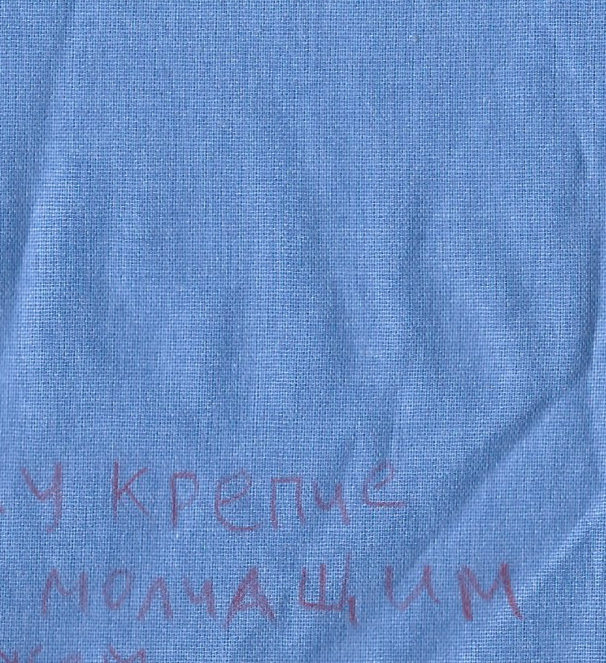
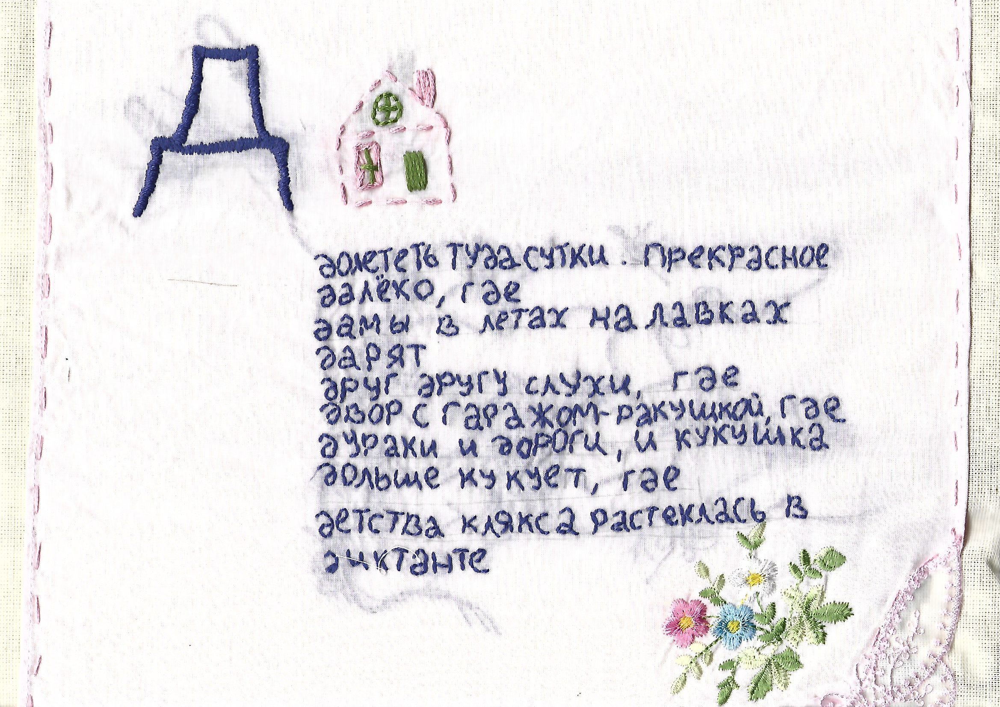

# Азбука двадцатых

## Концепт
Текстильная вышитая азбука загадок текущей эпохи 2020-х годов. На каждой странице зашифровано слово из современного контекста. Как общие слова, так и свойственные только нашим "сегодня". Пока вышита половина алфавита: от А до О.


### Как читать?
- На каждой странице стихотворение с буквой
- Каждая буква = одно слово, начинающееся на эту же букву
- Вышитая картинка - подсказка к отгадке

кликай на фото чтобы увидеть поближе


```
А-А-А

азы инфляции постигая на кассе,
аппетит сокращаю,

абракадабра:
актив приумножается

аномалия социального поведения в
анатомии толпы, где
акцент на идее и каждый на ты
```


```
Б-Б-Б

большинство пристроено, чтоб не
бедствовать,
бал воротничков,
блогеров, заводчан
боже, хорошо ли, что процент так мал?
```


### Материалы:
- мулине
- окрашенные акрилом кусочки хлопка
- покрытие от советского матраса
- монетки
- поэзия


```
Г-Г-Г

Господин, пройдя терапию, их расставляет
Географический азарт
Горизонты расширяем
```



```
Д-Д-Д

долететь туда сутки, прекрасное
далёко, где
дамы в летах на лавках
дарят
друг другу слухи, где
двор с гаражом-ракушкой, где
дураки и дороги, и кукушка
дольше кукует, где
детства клякса растеклась в
диктанте
```


```
К-К-К

красивая былинка:
котик пошутил
катится смешинка, но
кролик не заценил
кошачью шутку.
краснела вся земля,
корчится и кролик от стыда
```


```
Л-Л-Л

лелеет людей,
лепит для них детей,
ластится к каждой судьбе
ласкает людей,
лжет побольней,
ликует в моем животе
```


```
М-М-М

мужчина
мечты из фантазии
магически
мил в своем
многообразии
```


```
Н-Н-Н

начался денёк
надо всё прочесть
налистаюся по горло и
не упущу

ночка началась
настроенье есть
насмотрюся до тревоги
на беду
```

