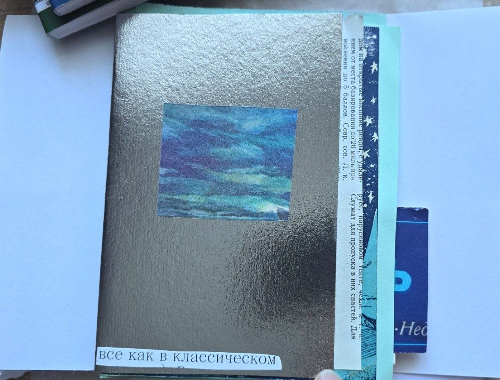
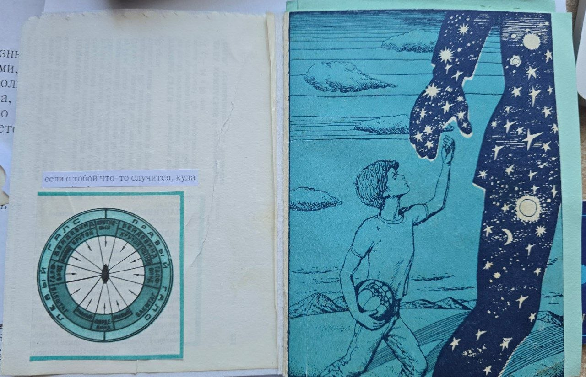
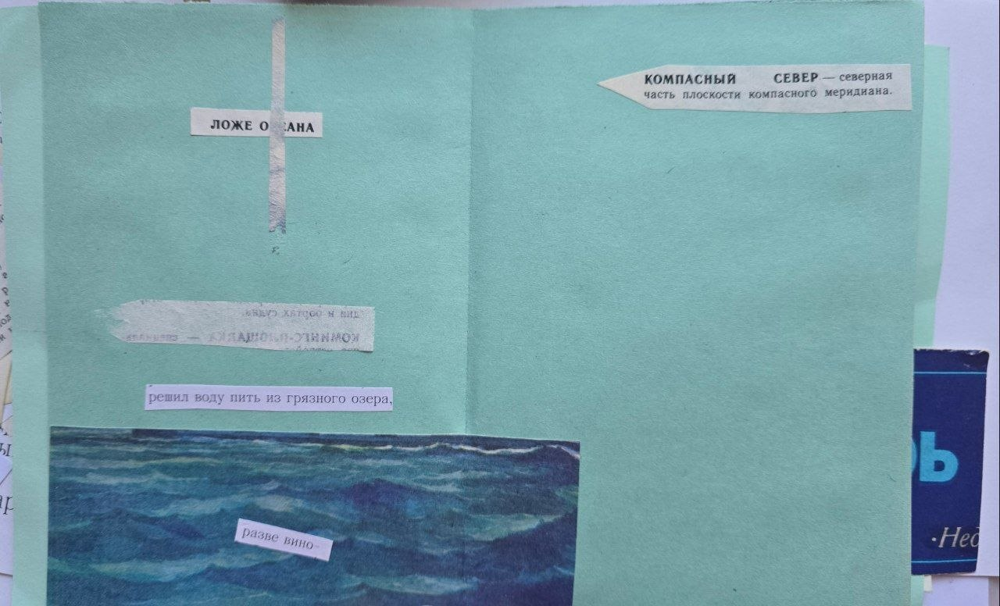
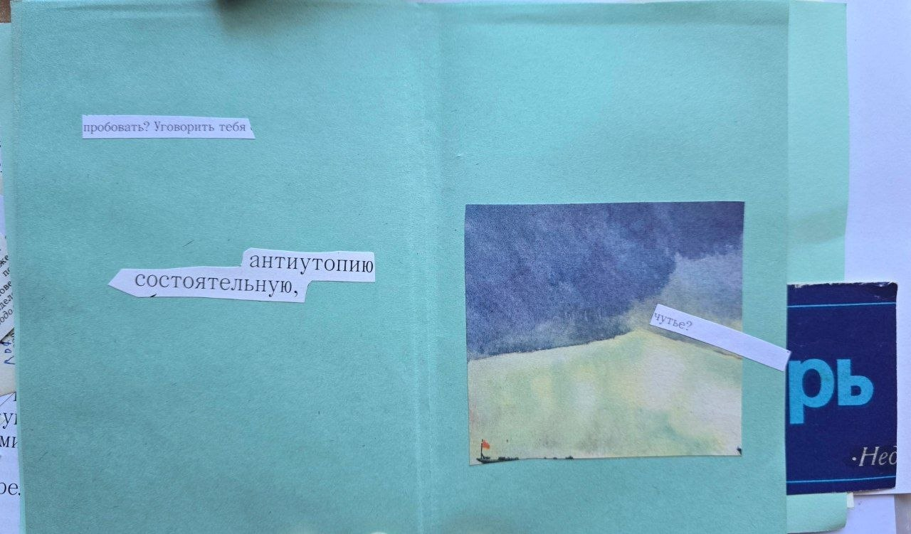
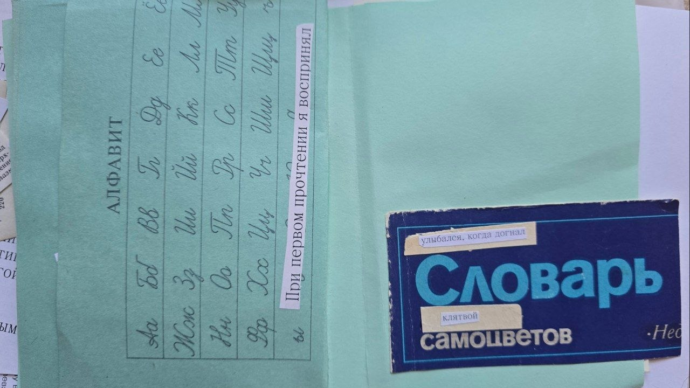
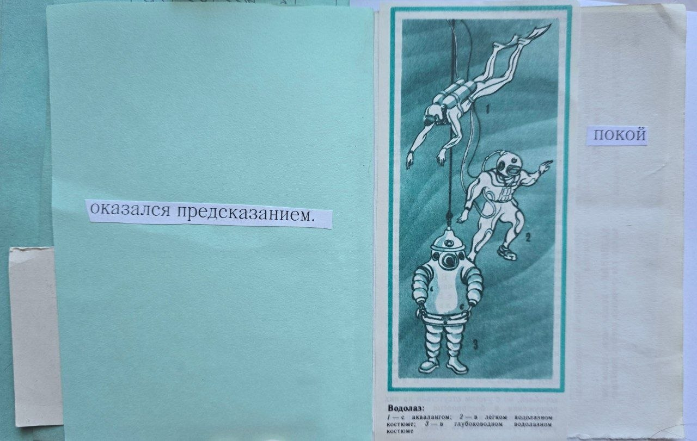
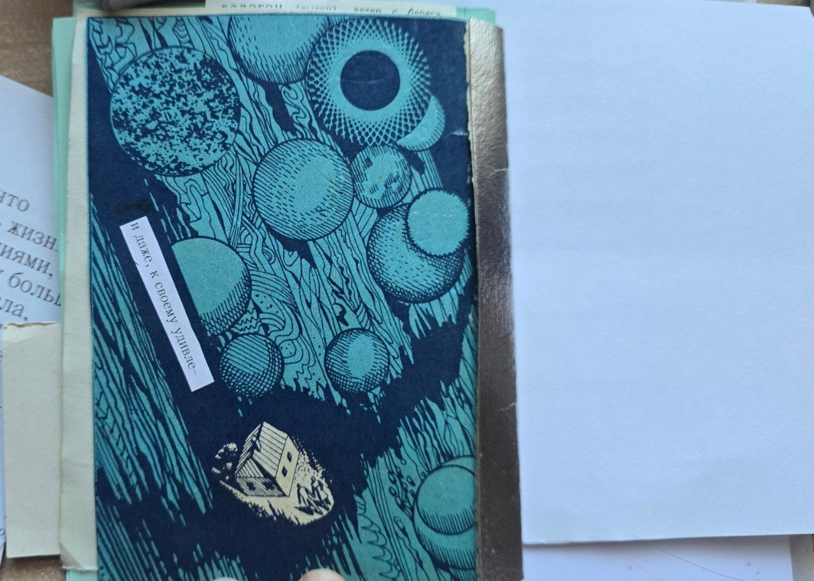

# Зин первый

## материалы
Оставалось найти учительницу: ею стала преподавательница латыни Элис Коуэн (от нее, вспоминала писательница, «все время пахло сельдереем»). Узнав, что юная Энн интересуется древнегреческим языком, она предложила заниматься им в обеденный перерыв: больше никому в школе греческий был не нужен. «Мы вместе читали Сапфо, и это было просто революционно», — рассказывала Карсон. 
Оставалось найти учительницу: ею стала преподавательница латыни Элис Коуэн (от нее, вспоминала писательница, «все время пахло сельдереем»). Узнав, что юная Энн интересуется древнегреческим языком, она предложила заниматься им в обеденный перерыв: больше никому в школе греческий был не нужен. «Мы вместе читали Сапфо, и это было просто революционно», — рассказывала Карсон. 

Оставалось найти учительницу: ею стала преподавательница латыни Элис Коуэн (от нее, вспоминала писательница, «все время пахло сельдереем»). Узнав, что юная Энн интересуется древнегреческим языком, она предложила заниматься им в обеденный перерыв: больше никому в школе греческий был не нужен. «Мы вместе читали Сапфо, и это было просто революционно», — рассказывала Карсон.   

- Военно-морской словарь А-М
- Журнал Научная фантастика 80-е
- картонка от доставки японской еды

