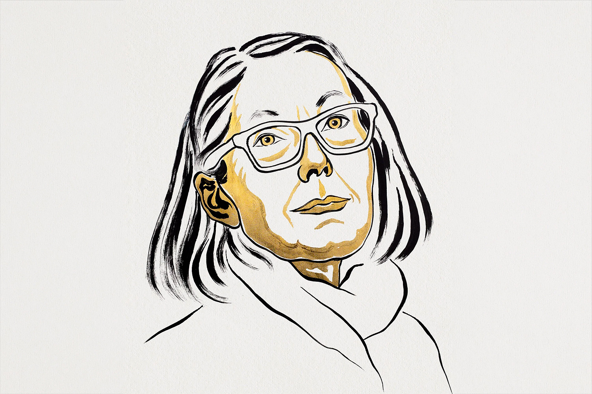
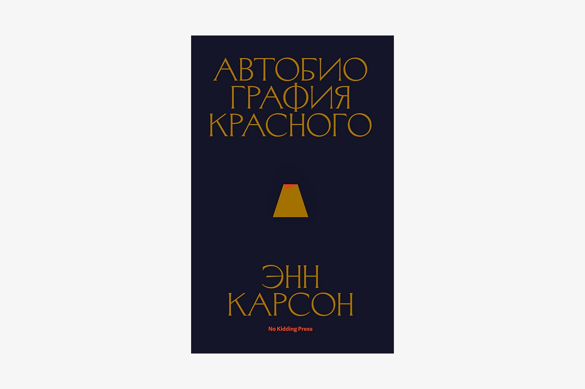

# Нобелевскую премию получила Энн Карсон. Она пишет свои книги на руинах античности

Канадской поэтессе, эссеистке и переводчице Энн Карсон присудили Нобелевскую премию по литературе «за смелое и изобретательное творчество, которое в игривом диалоге с классической традицией создало новые формы для современной литературы». 

- [ ] Егор Михайлов рассказывает о том, как Карсон творит на руинах античной поэзии — и чем она похожа на лису.

- [x] «Я прославлюсь через пятнадцать минут после смерти», — шутила Энн Карсон, когда ей было уже за сорок, а издательства продолжали отвергать ее стихи. К счастью, она была неправа: в семьдесят шесть лет канадская поэтесса и писательница не только жива, но и присоединилась к пантеону главных авторов мира.

Карсон родилась в Торонто в семье банковского служащего. Каждые три года банк переводил управляющих на новое место, так что детство писательницы прошло в переездах по маленьким городкам Онтарио: Стони-Крик, Порт-Хоуп, Тимминс. Однажды, отъезжая от очередного дома и махая из машины выстроившимся у забора лучшим друзьям, девочка решила: «В следующий раз, куда бы я ни приехала, я просто не буду заводить друзей — в этом нет никакого будущего».

Переводчица Эмили Уилсон отмечает, что Карсон всю жизнь любила примерять на себя разные роли. 

- Сначала она изображала «мужественного и сдержанного» отца-банкира, потом переключилась на Оскара Уайльда.
- В старших классах Карсон с друзьями одевалась в манере ирландского классика, заучивала его афоризмы и разыгрывала в столовой разговоры, «будто мы были Оскаром Уайльдом и его друзьями».

> Любовь кумира к античной культуре привела Карсон к новой, самой важной страсти. Наткнувшись в торговом центре на билингвальный томик поэзии Сапфо, она решила выучить язык, чтобы стать «еще больше похожей на Оскара Уайльда».

Оставалось найти учительницу: ею стала преподавательница латыни Элис Коуэн (от нее, вспоминала писательница, «все время пахло сельдереем»). Узнав, что юная Энн интересуется древнегреческим языком, она предложила заниматься им в обеденный перерыв: больше никому в школе греческий был не нужен. «Мы вместе читали Сапфо, и это было просто революционно», — рассказывала Карсон. 

## Как она пишет

Творчество Карсон с трудом:
1. поддается классификации: главный ее роман 
2. «Автобиография красного» написан стихами, переводы похожи 
3. на авторские поэмы, а научные статьи — на исповедь. Сама она объясняет это 

Творчество Карсон с трудом:
1. поддается классификации: главный ее роман 
2. «Автобиография красного» написан стихами, переводы похожи 
3. на авторские поэмы, а научные статьи — на исповедь. Сама она объясняет это ё
4. вав
5. аолвтбо в
6. папврп

желанием «избежать заточения в рамках одной роли, занимаясь множеством разных вещей». Эмили Уилсон в своем профайле вспоминает цитату древнегреческого поэта Архилоха: «Лиса знает много разных вещей, а еж — одну, но самую главную», — подразумевая, что Карсон, конечно, больше похожа на лису.

Один из ключей к своему методу Карсон раскрывает в эссе «Красное мясо: что сделал Стесихор?», которым открывается «Автобиография красного». У Гомера, напоминает Карсон, каждый элемент бытия прибит к своим эпитетам: «Если Гомер упоминает кровь, кровь черная. Когда появляются женщины, они прекраснолодыжные и быстроглазые. У Посейдона всегда синие брови Посейдона. Смех богов неугасимый. Море немолчношумящее. Ноги людей быстрые. Смерть злая». Эти прилагательные она называет «защелками бытия».